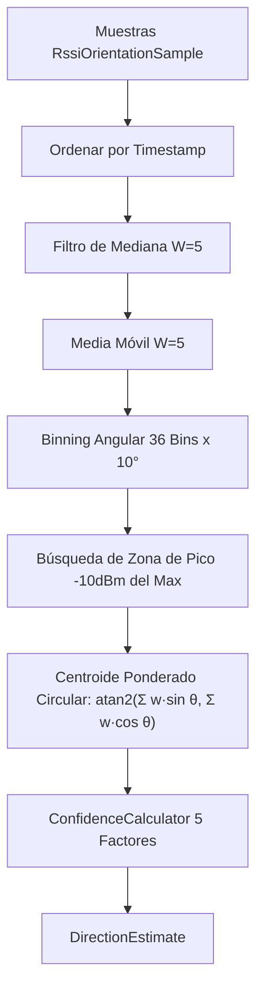

# Arquitectura Técnica de VisorWifi (`ARCHITECTURE.md`)

Este documento detalla el diseño de arquitectura, los flujos de datos y los patrones de implementación del proyecto **VisorWifi**.

---

## 1. Visión General de Arquitectura

VisorWifi sigue los principios de **Clean Architecture** adaptados a aplicaciones de diagnóstico en tiempo real:

```
[ Capa de Presentación (UI) ]
  Jetpack Compose + StateFlow
        │
        ▼
[ Capa de ViewModel ]
  NetworkDiagnosisViewModel / ApLocatorViewModel
        │
        ▼
[ Capa de Dominio y Motores ]
  NetworkDiagnosisEngine / HybridDiagnosisEngine / RssiDirectionAnalyzer / ConfidenceCalculator
        │
        ▼
[ Capa de Servicios y Datos ]
  NetworkMonitorService / SensorOrientationManager / WifiManager
```

---

## 2. Flujo de Datos Telemétricos en Tiempo Real


---

## 3. Módulo AP Locator (Procesamiento de Señal y Orientación)

### 3.1 Adquisición de Sensores (`SensorOrientationManager`)
- **Fusión de Sensores**: Utiliza `TYPE_ACCELEROMETER` + `TYPE_MAGNETIC_FIELD` enviando matrices a `SensorManager.getRotationMatrix()`. Si el dispositivo carece de magnetómetro, utiliza `TYPE_ROTATION_VECTOR`.
- **Filtro de Paso Bajo (Low-Pass Filter)**: Se aplica $\alpha = 0.25$ sobre la aceleración y vector geomagnético para suprimir vibraciones de mano.
- **Interpolación Circular**: La transición $359^\circ \leftrightarrow 0^\circ$ se interpola manejando la diferencia angular mínima ($\pm 180^\circ$) para evitar rotaciones bruscas de $358^\circ$ en la UI.

### 3.2 Algoritmo de Estimación (`RssiDirectionAnalyzer`)



### 3.3 Motor de Confianza (`ConfidenceCalculator`)

Factor | Peso (%) | Fórmula / Umbrales
---|---|---
**Cantidad Muestras** | 20% | $0$ si $< 12$; lineal entre $12$ y $36+$
**Rango RSSI** | 25% | $0$ si $< 5\text{ dBm}$; $100\%$ si $\ge 25\text{ dBm}$
**Varianza Pico** | 20% | Desviación estándar en bin de pico ($< 2.0\text{ dBm} \rightarrow 100\%$)
**Cobertura Angular** | 20% | $(\text{Grados Cubiertos} / 360^\circ) \times \text{Densidad Muestras}$
**Consistencia Pico** | 15% | Ancho de zona de pico $\ge 3$ bins y ventaja sobre promedio $\ge 10\text{ dBm}$

---

## 4. Motor de Diagnóstico Híbrido de Red

```
                     ┌──────────────────────────────┐
                     │    NetworkMetrics (10-300s)  │
                     └──────────────┬───────────────┘
                                    │
            ┌───────────────────────┴───────────────────────┐
            ▼                                               ▼
┌────────────────────────┐                     ┌────────────────────────┐
│ NetworkDiagnosisEngine │                     │ LightWeightClassifier  │
│   (Fase 1 Heurística)  │                     │   (Fase 2 IA Local)    │
└───────────┬────────────┘                     └───────────┬────────────┘
            │                                               │
            └───────────────────────┬───────────────────────┘
                                    ▼
                       ┌─────────────────────────┐
                       │  HybridDiagnosisEngine  │
                       │   (Fusión e Inferencia) │
                       └────────────┬────────────┘
                                    ▼
                           [DiagnosisState]
```

---

## 5. Estrategia de Pruebas Unitarias

Todas las pruebas unitarias se encuentran en `app/src/test/java/`.

### Regla Fundamental:
Los algoritmos (`RssiDirectionAnalyzer`, `ConfidenceCalculator`, `PeriodAnalyzer`, `LightWeightClassifier`) deben ser **funciones puras** independientes del framework de Android. Esto permite ejecutar la suite completa de pruebas unitarias en **< 30 segundos** sin requerir Robolectric ni emulador.

### Comando para Ejecución de Pruebas:
```powershell
$env:JAVA_HOME="C:\Program Files\Android\Android Studio\jbr"
.\gradlew :app:testDebugUnitTest
```
