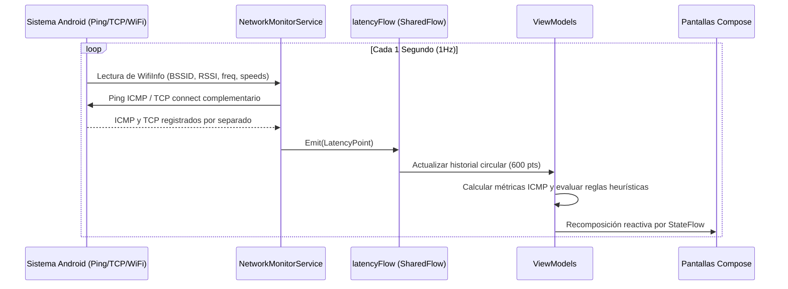
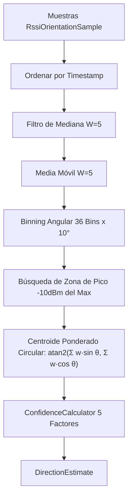

# Arquitectura Técnica de VisorWifi (`ARCHITECTURE.md`)

Este documento detalla el diseño de arquitectura, los flujos de datos y los patrones de implementación del proyecto **VisorWifi**.

---

## 1. Visión General de Arquitectura

VisorWifi organiza el código por responsabilidades (UI, ViewModels, motores y acceso al sistema), con algunas dependencias directas entre capas:

```
[ Capa de Presentación (UI) ]
  Jetpack Compose + StateFlow + ModeSwitcher
        │
        ▼
[ Capa de ViewModel ]
  NetworkDiagnosisViewModel / ApLocatorViewModel
        │
        ▼
[ Capa de Dominio y Motores ]
  NetworkDiagnosisEngine (activo) / HybridDiagnosisEngine (prototipo inactivo) / RssiDirectionAnalyzer / ConfidenceCalculator / PdfGenerator
        │
        ▼
[ Capa de Servicios y Proveedores de Datos ]
  NetworkMonitorService (1Hz Flow)  │  WifiInfoProvider (Consulta Desacoplada)
  SensorOrientationManager (Sensores)│  WifiManager & ConnectivityManager
```

---

## 2. Flujo de Datos Telemétricos en Tiempo Real

### 2.1 Flujo por Servicio en Primer Plano (Foreground Service)


### 2.2 Flujo Desacoplado para AP Locator (`WifiInfoProvider`)
Cuando el usuario entra directamente a la pantalla de **AP Locator** sin tener iniciado el servicio de monitoreo en segundo plano, `ApLocatorViewModel` ejecuta un polling directo e independiente mediante `WifiInfoProvider`:
- Consulta `WifiSnapshot` instantáneo cada 1 segundo en una corrutina aislada con `viewModelScope`.
- Lee los resultados de escaneo que Android tenga disponibles (`getAvailableAps`); no solicita un escaneo nuevo en cada consulta, por lo que pueden estar desactualizados.
- Registra muestras atómicas `RssiOrientationSample` durante la calibración 360°.
- La captura compara el BSSID conectado con el BSSID seleccionado y detiene la medición si difieren. En la práctica, la estimación requiere estar conectado al AP seleccionado.

---

## 3. Módulo AP Locator (Procesamiento de Señal y Orientación)

### 3.1 Adquisición de Sensores (`SensorOrientationManager`)
- **Fusión de Sensores**: Utiliza `TYPE_ACCELEROMETER` + `TYPE_MAGNETIC_FIELD` enviando matrices a `SensorManager.getRotationMatrix()`. Si el dispositivo carece de magnetómetro, utiliza `TYPE_ROTATION_VECTOR`.
- **Filtro de Paso Bajo (Low-Pass Filter)**: Se aplica $\alpha = 0.25$ sobre la aceleración y vector geomagnético para suprimir vibraciones de mano.
- **Interpolación Circular**: La transición $359^\circ \leftrightarrow 0^\circ$ se interpola manejando la diferencia angular mínima ($\pm 180^\circ$) para evitar rotaciones bruscas de $358^\circ$ en la UI.

### 3.2 Algoritmo de Estimación (`RssiDirectionAnalyzer`)



### 3.3 Motor de Confianza (`ConfidenceCalculator`)

Factor | Peso (%) | Fórmula / Umbrales
---|---|---
**Cantidad Muestras** | 20% | $0$ si $< 12$; lineal entre $12$ y $36+$
**Rango RSSI** | 25% | $0$ si $< 5\text{ dBm}$; $100\%$ si $\ge 25\text{ dBm}$
**Varianza Pico** | 20% | Desviación estándar en bin de pico ($< 2.0\text{ dBm} \rightarrow 100\%$)
**Cobertura Angular** | 20% | $(\text{Grados Cubiertos} / 360^\circ) \times \text{Densidad Muestras}$
**Consistencia Pico** | 15% | Ancho de zona de pico $\ge 3$ bins y ventaja sobre promedio $\ge 10\text{ dBm}$

---

## 4. Diagnóstico de red y trabajo futuro de IA

El monitor y los reportes usan actualmente `NetworkDiagnosisEngine`, un motor determinista basado en reglas. Utiliza estadísticas ICMP; si no hay respuestas ICMP suficientes, el monitor comunica que faltan datos para diagnosticar en vez de convertir una sonda TCP en latencia ICMP.

Los archivos `engine/ia/LightWeightClassifier` y `HybridDiagnosisEngine` conservan un prototipo determinista de puntuación heurística, pero no están conectados al monitor ni a los reportes. No hay IA ni aprendizaje automático implementado. Una IA real queda como trabajo futuro.

```
`NetworkMetrics` (ICMP) → `NetworkDiagnosisEngine` → `DiagnosisState`

El prototipo de `engine/ia` está fuera de este flujo.

Las sondas TCP se ejecutan como comprobación complementaria cuando ICMP falla. Sus tiempos y destinos se guardan por separado, se muestran en la tarjeta y el PDF, y no participan en las gráficas ni estadísticas ICMP de latencia, jitter o pérdida.

---

## 5. Motor de Generación de Reportes PDF (`PdfGenerator`)

`PdfGenerator` es una capa de presentación: recibe un `ReportData` ya consolidado y no recalcula telemetría, score de estabilidad ni diagnóstico. Genera un documento A4 de tres páginas:

1. **Resumen ejecutivo y diagnóstico:** estado del periodo, duración, muestras, score, indicadores LAN/WAN/WiFi, evidencias y recomendación del motor heurístico.
2. **Métricas técnicas detalladas:** grupos independientes para LAN, WAN y WiFi; incluye picos, pérdida ICMP, jitter, TCP complementario, RSSI, PHY, banda y roaming, junto con sus referencias técnicas.
3. **Evidencia gráfica y cierre:** historiales de latencia y RSSI, eventos registrados, observaciones de campo y firmas.

La primera página añade una explicación contextual y una **Conclusión del monitoreo**. `ReportNarrativeGenerator` redacta ambas a partir de `PeriodAnalysis`, el estado del periodo y el diagnóstico ya calculado; no modifica umbrales, score, ni telemetría. En el caso específico de un periodo degradado únicamente por pocos picos WAN, aclara que la calificación incluye esos eventos aunque el comportamiento predominante haya sido estable.

- **Integridad de datos:** los valores mostrados proceden de `PeriodAnalysis`, `NetworkDiagnosisEngine` y el historial existente. Las sondas TCP permanecen separadas de las estadísticas ICMP de latencia, jitter y pérdida.
- **Escalado de gráficas:** MPAndroidChart se renderiza fuera de pantalla a `1400 × 430 px`. Al dibujarse en el PDF, los píxeles no se interpretan como puntos PDF: el destino se calcula a partir de la relación de aspecto, del ancho disponible y de una altura máxima segura. Las gráficas limitan las marcas de ejes, reducen la tipografía de ejes y leyenda, y mantienen visibles las unidades `ms` y `dBm` para aprovechar el área de datos en A4.
- **Sanitización tipográfica (`sanitizePdfText`):** normaliza ligaduras latinas (`fi`, `fl`, `ff`), guiones tipográficos, símbolos matemáticos, flechas y emojis antes del trazado para evitar caracteres faltantes en Skia PDF. Los datos originales de `ReportData` no se alteran.
- **Compatibilidad de pruebas:** los colores base del generador son valores ARGB directos, por lo que las pruebas JVM de sanitización pueden cargar el objeto sin requerir una implementación Android de `Color`.

---

## 6. Estrategia de Pruebas Unitarias

Las pruebas unitarias presentes se encuentran en `app/src/test/java/`.

### Suites presentes:
1. **`RssiDirectionAnalyzerTest`**: Filtros, bins angulares, estimación y casos de baja cobertura.
2. **`ApLocatorIndependenceTest`**: Casos relacionados con el funcionamiento desacoplado del AP Locator.
3. **`NetworkDiagnosisEngineTest`**: Casos saludables, WAN degradada, señal débil y ausencia de muestras ICMP.
4. **`PdfSanitizerTest`**: Sanitización de texto para PDF.
5. **`ExampleUnitTest`**: Prueba de ejemplo.

No hay suites específicas presentes para `ConfidenceCalculator`, `PeriodAnalyzer`, `PeriodStatusEvaluator`, `HybridDiagnosisEngine` o `LightWeightClassifier`.

### Regla Fundamental:
Los motores que se quieran probar como lógica JVM deben evitar dependencias Android. El clasificador experimental ya no depende de `android.util.Log`. No se ha medido aquí el tiempo de ejecución de la suite.

### Comando para Ejecución de Pruebas:
```powershell
$env:JAVA_HOME="C:\Program Files\Android\Android Studio\jbr"
.\gradlew :app:testDebugUnitTest
```
